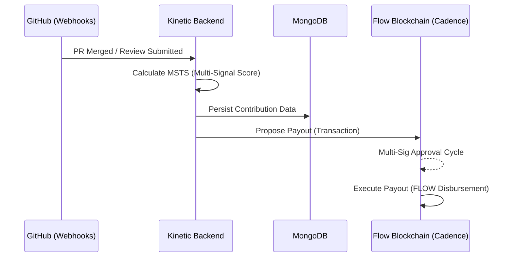
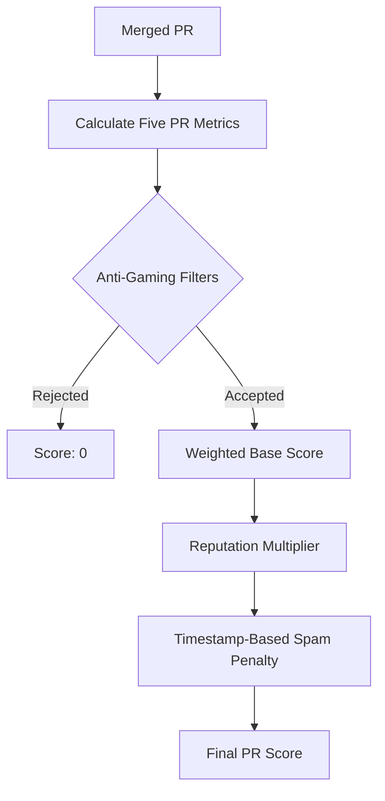

# Kinetic 

[](https://github.com/namish18/Kinetic)
[](LICENSE)
[](https://github.com/namish18/Kinetic)

**Kinetic** is a meritocratic funding platform purpose-built for Protocol Labs contributors. It replaces vanity "green square" metrics with a **mathematically rigorous scoring engine** that measures the true engineering complexity and ecosystem impact of open-source work.

### The Problem
Traditional bounty systems are "first-come, first-served" or based on simplistic commit counts. This leads to **micro-PR farming**, **code bloat**, and **reputation dominance**, where new, high-quality contributors struggle to compete against established "elites."

### The Solution - KINETIC
Kinetic evaluates five contribution metrics using its **MSTS engine**: impact, complexity, quality, review, and priority. It also applies a reputation multiplier and timestamp-based spam penalty when the required history is available.


---

## Table of Contents

- [Architecture Overview](#architecture-overview)
- [How to Run the Project](#how-to-run-the-project)
  - [Prerequisites](#prerequisites)
  - [Backend Setup](#backend-setup)
  - [Frontend Setup](#frontend-setup)
  - [Flow Blockchain Setup](#flow-blockchain-setup)
- [Features](#features)
  - [The Contribution Scoring Engine (MSTS v2)](#the-contribution-scoring-engine-msts-v2)
  - [Decentralized Identity](#decentralized-identity)
  - [Autonomous FLOW Payouts](#autonomous-flow-payouts)

- [Sponsor Integration](#sponsor-integration)
  - [Flow Blockchain](#flow-blockchain)
  - [Protocol Labs: DID & IPFS](#protocol-labs-did--ipfs)
- [Project Structure](#project-structure)
- [API Reference](#api-reference)
- [License](#license)

---

## Architecture Overview

Kinetic is organized as a monorepo consisting of three principal layers, achieving a seamless transition from code contribution to on-chain payout.



| Layer | Technology | Purpose |
|-------|-----------|---------|
| **Frontend** | Next.js 16, React 19, Tailwind CSS 4, GSAP | High-fidelity dashboard for organizations and contributors. |
| **Backend** | Node.js, Express, MongoDB, Passport (OAuth) | Scoring engine, DID management, and webhook orchestration. |
| **Blockchain** | Flow Testnet, Cadence, FCL | Secure, transparent treasury management and multi-sig distributions. |
---

## How to Run the Project

### Prerequisites

Ensure the following tools are installed on your system before proceeding:

- **Node.js** v20 or later
- **npm** v9 or later
- **MongoDB** (local instance or a hosted service such as MongoDB Atlas)
- **Git**
- **Flow CLI** (required only for smart contract development and deployment)

You will also need the following external accounts and credentials:

- A **GitHub OAuth Application** (Client ID and Client Secret)
- A **MongoDB** connection string
- A **Flow Testnet** account (for blockchain interactions)

### Backend Setup

1. Clone the repository and navigate to the backend directory:

   ```bash
   git clone <repository-url>
   cd kinetic/backend
   ```

2. Install dependencies:

   ```bash
   npm install
   ```

3. Create a `.env` file in the `backend/` directory with the following variables:

   ```env
   PORT=5000
   MONGODB_URI=<your-mongodb-connection-string>
   GITHUB_CLIENT_ID=<your-github-oauth-client-id>
   GITHUB_CLIENT_SECRET=<your-github-oauth-client-secret>
   SESSION_SECRET=<a-secure-random-string>
   JWT_SECRET=<a-secure-random-string>
   FRONTEND_URL=http://localhost:3000
   FLOW_ADDRESS=<your-flow-testnet-account-address>
   FLOW_PRIVATE_KEY=<your-flow-testnet-private-key>
   ```

4. Start the development server:

   ```bash
   npm run dev
   ```

   The API will be available at `http://localhost:5000`. A health check endpoint is accessible at `http://localhost:5000/health`.

### Frontend Setup

1. Navigate to the frontend directory:

   ```bash
   cd kinetic/frontend
   ```

2. Install dependencies:

   ```bash
   npm install
   ```

3. Create a `.env` file in the `frontend/` directory with the following variables:

   ```env
   NEXT_PUBLIC_FLOW_ADDRESS=<your-flow-testnet-contract-address>
   NEXT_PUBLIC_FLOW_NETWORK=testnet
   ```

4. Start the development server:

   ```bash
   npm run dev
   ```

   The application will be available at `http://localhost:3000`.

### Flow Blockchain Setup

The smart contract layer uses Cadence, the native language for the Flow blockchain. To deploy or modify contracts:

1. Navigate to the Flow directory:

   ```bash
   cd kinetic/backend/flow
   ```

2. To deploy the `KineticPayout` contract to the Flow Testnet:

   ```bash
   flow project deploy --network=testnet
   ```

3. To run Cadence scripts (read-only operations):

   ```bash
   flow scripts execute cadence/scripts/get_balance.cdc --network=testnet
   ```

4. To submit transactions (state-changing operations):

   ```bash
   flow transactions send cadence/transactions/propose_payout.cdc --network=testnet
   ```

Refer to the [Flow CLI Documentation](https://developers.flow.com/tools/flow-cli) for additional commands and configuration options.

---

## Features

### The Contribution Scoring Engine

Kinetic moves beyond "vanity metrics" (like commit counts or lines of code) by employing a multi-stage scoring pipeline. The engine evaluates contribution quality and impact, while payout amounts are calculated separately using the resulting PR or organization contributor scores.


#### 2. The Algorithmic Pipeline



#### 3. Core Scoring Components

| Layer | Component | Description |
| :--- | :--- | :--- |
| **Filter** | **Anti-Gaming** | Rejects PRs with quality below 0.3 or review below 0.3, and PRs where both impact and complexity are below 0.2. |
| **Base** | **Impact & Complexity** | Impact uses changed files and commit count; complexity uses logarithmic scaling of additions and deletions, capped at 10,000 changed lines. |
| **Base** | **Review** | Calculated from the number of review comments using `min(1, (review_comments / 10) + 0.5)`. |
| **Base** | **Quality** | Starts at 0.8; adds 0.1 if deletions exceed additions and 0.1 if the PR is merged, capped at 1.0. |
| **Base** | **Priority** | Scores 1.0 when a PR label contains priority, high, critical, or urgent; otherwise scores 0.4. |
| **Incentive** | **Reputation (1.5x cap)** | A multiplier based on accepted PR count, average review score, historical impact, and consistency; normalized logarithmically and capped at 1.5x. |
| **Stability** | **Spam Penalty** | Applies a timestamp-based penalty using PR submission history; submissions less than 10 minutes apart trigger an additional 20% penalty. |

#### 4. The Math Behind the Meritocracy

The final PR score is calculated as:

$$
FinalScore = round(BaseScore \times ReputationMultiplier \times SpamPenalty, 4)
$$

The base score is the weighted sum of five PR metrics: impact, complexity, quality, review, and priority. The reputation multiplier is logarithmically normalized and capped at 1.5. The spam penalty is based on available PR timestamp history; when no timestamp history is supplied, the penalty is 1.0.

### Decentralized Identity

Contributors authenticate via GitHub OAuth. Upon first login, Kinetic mints a **Decentralized Identifier (DID)** using the `key-did-provider-ed25519` standard from the Ceramic / Protocol Labs stack. DID documents are stored on an in-process Helia IPFS node. This cryptographic identity binds a contributor's commits, pull requests, and issues as verifiable credentials.

### Autonomous FLOW Payouts

Payout distribution is handled entirely on-chain through the `KineticPayout` Cadence smart contract deployed on the Flow Testnet. The contract supports:

- **Treasury Management** -- Organizations deposit FLOW tokens into a managed treasury vault.
- **Payout Proposals** -- Authorized signers submit payout batches specifying recipient addresses and amounts.
- **Multi-Signature Approvals** -- Payouts require a configurable threshold of approvals from authorized signers before execution.
- **Direct Execution** -- Once the approval threshold is met, funds are disbursed directly to contributor wallets.

The frontend integrates with the Flow Client Library (FCL) for wallet authentication, balance queries, and transaction signing. Contributors can connect their Flow wallet, view pending payouts, and approve or execute distributions directly from the dashboard.

---

## Sponsor Integration

Kinetic has been built in direct collaboration with its hackathon sponsors, integrating their technologies as foundational infrastructure rather than superficial branding.

### Flow Blockchain

Flow serves as the settlement layer for all contributor payouts. The integration spans the full stack:

- **Smart Contracts**: The `KineticPayout.cdc` contract, written in Cadence, manages treasury deposits, payout proposals, multi-signature approvals, and token disbursement on the Flow Testnet.
- **Backend Services**: The `flowService.js` module handles server-side interactions with the Flow network, including transaction construction and submission.
- **Frontend Integration**: The FCL library is configured in `src/lib/flow.ts` to connect to the Flow Testnet access node and discovery wallet. All read operations (treasury balance, payout details, signer lists) and write operations (submit, approve, execute payouts, deposit funds) are implemented as typed wrapper functions.
- **Visual Presence**: The Flow logo is prominently featured in the `OrbitingEcosystem` component on the landing page, orbiting the central Kinetic icon alongside other ecosystem partners.

### Protocol Labs: DID & IPFS

Protocol Labs' decentralized identity and storage technologies serve as the backbone for Kinetic's contributor verification and data persistence:

- **Decentralized Identity (DID)**: Kinetic implements the `key-did-provider-ed25519` standard to mint unique, sovereign DIDs for every contributor upon GitHub authentication. This ensures that reputation and scoring are tied to a cryptographic identity rather than just a platform-specific username.
- **IPFS Persistence**: DID documents and verifiable contribution snapshots are stored and resolved using an in-process **Helia IPFS node**. This ensures that the metadata powering the meritocratic engine is decentralized, tamper-proof, and highly available.
- **Ceramic Integration**: The system leverages the Ceramic network's principles for verifiable data streams, ensuring that a contributor's scoring history is transparent and auditable across the Protocol Labs ecosystem.
- **Visual Presence**: The Protocol Labs and IPFS logos are prominently featured in the `OrbitingEcosystem` component on the landing page, symbolizing the core infrastructure that powers Kinetic's trustless scoring.

---

## Project Structure

```
kinetic/
  backend/
    config/             # Database connection and Passport OAuth configuration
    flow/
      cadence/
        contracts/      # KineticPayout.cdc smart contract
        scripts/        # Read-only Cadence scripts
        transactions/   # State-changing Cadence transactions
        tests/          # Cadence integration tests
      flow.json         # Flow project configuration
    models/             # Mongoose data models
    routes/             # Express route handlers (auth, contribution, kinetic, repo, webhook)
    services/           # Core business logic (contribution scoring, DID, Flow, kinetic mechanisms)
    server.js           # Application entry point
  frontend/
    src/
      app/              # Next.js App Router pages (dashboard, bounties, docs, voting, onboarding)
      components/       # Reusable UI components (PillNav, LogoLoop, OrbitingEcosystem, etc.)
      lib/              # Shared utilities and Flow blockchain client (flow.ts)
  contribution_algo.md  # Detailed specification of the contribution scoring algorithm
  readme.md             # This file
```

---

## API Reference

The backend exposes the following primary endpoints:

| Method | Endpoint | Description |
|--------|----------|-------------|
| `GET` | `/api/auth/github` | Initiate GitHub OAuth authentication flow |
| `GET` | `/api/auth/github/callback` | OAuth callback; creates DID on first login |
| `GET` | `/api/auth/me` | Retrieve current user profile (JWT required) |
| `GET` | `/api/auth/did/:username` | Resolve a DID by GitHub username (public) |
| `GET` | `/api/auth/did-resolve/self` | Re-resolve the authenticated user's DID (JWT required) |
| `PUT` | `/api/auth/wallet` | Link a Flow wallet address to the authenticated account (JWT required) |
| `GET` | `/api/auth/logout` | Terminate the current session |
| `GET` | `/health` | Health check endpoint |

Additional routes are available under `/api/contribution`, `/api/kinetic`, `/api/org`, and `/api/webhook` for contribution scoring, kinetic mechanism queries, organization repository management, and GitHub webhook processing, respectively.

---

## License

This project is licensed under the ISC License. See the repository for details.
